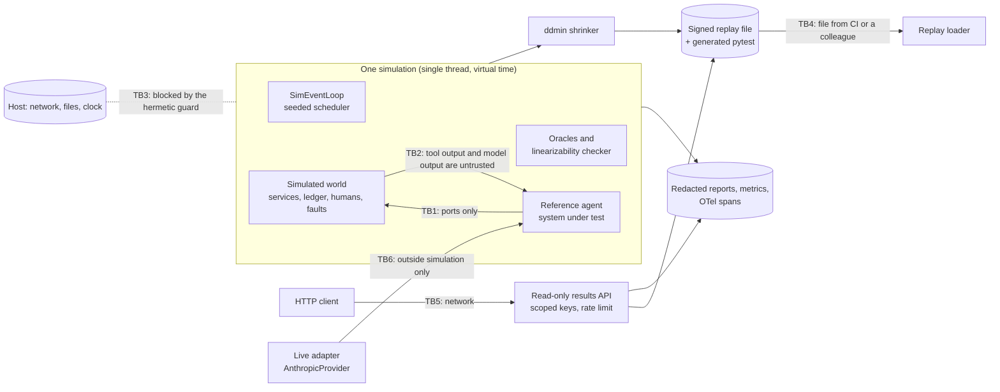

# Threat model

Method: STRIDE per trust boundary. Each row maps a threat to the control that addresses it and
to the test, bench script or CI job that shows the control works. `scripts/check_baseline.py`
verifies that every backticked evidence reference exists.

This repository is a verification tool. Its most important asset is the **correctness of its
verdicts**: a simulator that reports "clean" for a buggy agent, or a replay file that lies about
what it reproduces, does more harm than no simulator. The second asset is the **reference agent's
safety controls**, which the simulator attacks on purpose (prompt injection, approval bypass,
budget overrun, duplicate effects) and which must hold on the clean build.

## System and trust boundaries

Assets: correctness of verdicts (no false "clean", no false repro), integrity of replay files and
generated tests, the replay HMAC key, the reference agent's controls (recipient policy, budget,
approval ledger, idempotency), synthetic customer data and canary tokens in reports, API keys of
the results API, and the Anthropic API key of the optional live adapter.

Assumptions: the host running a campaign is trusted; the replay HMAC key is a CI secret shared
by one team; the results API sits behind TLS; the live adapter is never used inside a
simulation (the simulated loop forbids the threads it needs, the hermetic guard blocks
`threading.Thread.start` and sockets, and the SDK is imported lazily so no offline path loads it).

## STRIDE table

| ID | STRIDE | Threat | Entry point / asset | Control | Test / evidence | Residual risk |
|---|---|---|---|---|---|---|
| S1 | Spoofing | Caller guesses, replays or brute-forces a results-API key | TB5 | Keys held as SHA-256 digests; constant-time compare against every digest; fail closed with no keys; uniform 401 | `tests/unit/test_security.py::test_every_configured_digest_is_compared_without_early_exit`, `tests/integration/test_app.py::test_protected_endpoint_requires_a_valid_api_key` | No expiry or rotation workflow |
| S2 | Spoofing | A valid key reads or verifies beyond its purpose | TB5, results API | Per-key scopes (`results:read`, `repros:verify`); a key without the scope gets 403; scoped keys authenticate and are rate-limited per key | `tests/integration/test_results_api.py::test_every_route_requires_its_scope`, `tests/integration/test_results_api.py::test_scoped_keys_ignore_oversized_or_missing_keys` | Scopes are coarse (two) |
| S3 | Spoofing | A forged replay file claims a failure (or a fix) it does not reproduce | TB4, replay loader | HMAC-SHA256 over the canonical document (key id included), verified in constant time before parsing; unknown key ids and unsigned files rejected; no default key | `tests/unit/test_shrink_replay_emit.py::test_any_tampered_field_is_rejected`, `tests/unit/test_shrink_replay_emit.py::test_unsigned_foreign_oversized_and_malformed_files_are_rejected`, `tests/unit/test_shrink_replay_emit.py::test_keyring_requirements`, `tests/integration/test_results_api.py::test_verify_accepts_signed_documents_and_rejects_forgeries` | HMAC is symmetric: anyone holding the key can sign (ADR 0005) |
| S4 | Spoofing | The agent approves its own side effect, or an approval is consumed by another plan | Approval ledger | Separation of duties (the requester cannot decide); consume-once per consumer token; the `consume_once` and `ledger_linearizable` oracles judge every run | `tests/unit/test_world.py::test_ledger_consume_once_ttl_and_crash_semantics`, `tests/unit/test_linearizability.py::test_denials_forbidden_self_approval_and_unknown_ids`, `tests/unit/test_oracles.py::test_consume_once_and_call_budget_and_decision_bound` | The simulated reviewer is a model of a human, not a human |
| T1 | Tampering | A replay file is edited to point the regression test at another scenario or to inject code into the generated test | TB4, `emit.py` | Signature check before parsing; strict schema; the generated test embeds only the seed, an invariant name from the known list and a file name matching a strict pattern | `tests/unit/test_shrink_replay_emit.py::test_emission_refuses_unexpected_content`, `tests/unit/test_shrink_replay_emit.py::test_emitted_regression_tests_are_valid_python` | None known |
| T2 | Tampering | Arguments change between approval and execution (approval bypass on retry, stale approval reuse) | Reference agent, ledger | Approval bound to the canonical hash of tool plus arguments; every effect must cite an approval consumed for exactly its arguments and exactly this effect (`approval_fresh`); planted bugs show the oracle fires | `tests/unit/test_oracles.py::test_every_effect_needs_a_fresh_consumed_approval_of_its_own`, `tests/integration/test_sensitivity.py::test_each_planted_bug_is_found_and_trips_its_oracle`, `tests/unit/test_agent_actions_and_live.py::test_validated_actions_are_bound_to_the_canonical_call_hash` | Found only if the simulated faults reach the path; see sensitivity numbers in the README |
| T3 | Tampering | The agent's audit trail is edited, reordered or truncated | Audit chain | Hash chain over canonical JSON, checked by the `audit_chain_valid` oracle on every append and at the end, where the chain must still be the one the run appended to (the oracle anchors the head and the number of appends, so truncation and forks fail too); exported chains verify with `das audit verify` against an expected head | `tests/unit/test_oracles.py::test_audit_chain_is_checked_per_append_and_at_the_end`, `tests/unit/test_oracles.py::test_a_truncated_or_forked_audit_chain_is_detected`, `tests/unit/test_world.py::test_audit_chain_detects_edits_and_verifies_with_the_audit_kit`, `tests/unit/test_audit.py::test_any_single_byte_change_is_detected`, `tests/integration/test_cli.py::test_audit_verify` | Whoever can rewrite the whole chain *and* the anchor can rebuild both; no injected fault attacks the chain, so the oracle fires in tests rather than in campaigns (README Non-goals) |
| T4 | Tampering | Compromised dependency, base image or CI action | Build pipeline | uv.lock with hashes; pip-audit; base images pinned by digest; trivy scan; CycloneDX SBOM; Dependabot | `.github/workflows/ci.yml#pip-audit`, `.github/workflows/ci.yml#docker` | Actions are tag-pinned until SHA pinning at publish time |
| T5 | Tampering | Simulator nondeterminism (platform, hash seed, host clock) makes a verdict irreproducible, so a real failure cannot be replayed | Kernel | Integer virtual time; SplitMix64 with integer arithmetic; traces carry no floats; deterministic task names; trace hashes compared across reruns, hash seeds and operating systems; in strict mode (the default) host-clock reads (`time.time`, `time.monotonic`, `datetime.now`...) and process-wide entropy (`random` module functions, `os.urandom`, `uuid4`, `secrets`) raise and fail the `hermetic` oracle | `tests/integration/test_determinism.py::test_reruns_of_a_seed_produce_identical_traces`, `tests/integration/test_determinism.py::test_trace_hashes_do_not_depend_on_python_hash_randomization`, `tests/integration/test_determinism.py::test_golden_hashes_match_on_this_platform`, `tests/unit/test_hermetic.py::test_the_host_clock_is_blocked_in_strict_mode`, `tests/unit/test_hermetic.py::test_host_entropy_is_blocked_in_strict_mode`, `tests/unit/test_hermetic.py::test_a_simulated_agent_that_reads_the_host_clock_is_reported`, `.github/workflows/ci.yml#determinism-compare` | A C extension, `ctypes` or a clock read through a name imported before the run is still invisible; `strict=False` turns these checks off |
| R1 | Repudiation | Dispute over what the agent did in a failing run | Reports, audit chain | Every run has a trace hash; shrunk runs keep the trace, the audit chain (exported as verifiable JSONL) and OTel spans | `tests/unit/test_shrink_replay_emit.py::test_trace_spans_export_rpcs_as_child_spans`, `tests/integration/test_cli.py::test_demo_runs_offline_end_to_end` | Virtual timestamps are not wall-clock evidence |
| I1 | Information disclosure | Canary tokens planted in injected tool output, or customer PII, leak into reports, traces or API responses | Reports, results API | Canary pattern and core PII redaction on every report string, trace line and span attribute; replay files carry no ticket text; API responses redacted | `tests/unit/test_shrink_replay_emit.py::test_reports_redact_canaries_and_pii`, `tests/integration/test_results_api.py::test_campaign_summaries_are_listed_and_redacted`, `tests/integration/test_cli.py::test_campaign_without_a_key_still_writes_redacted_reports` | Pattern-based redaction misses free-form identifiers; all workload data is synthetic |
| I2 | Information disclosure | PII or secrets in logs; error bodies leak exception text | Logs, HTTP errors | structlog redaction processor; fixed error codes; validation errors without input | `tests/unit/test_logging.py::test_exception_tracebacks_are_redacted`, `tests/integration/test_app.py::test_unhandled_exceptions_become_generic_500s`, `tests/integration/test_app.py::test_validation_errors_never_echo_submitted_values` | Pattern-based |
| I3 | Information disclosure | Path traversal or arbitrary file reads through the results API | TB5 | Campaign names must match `^[a-z0-9][a-z0-9_-]{0,63}$`; only `*.json` in two fixed folders are read; listings capped | `tests/integration/test_results_api.py::test_unknown_or_unsafe_campaign_names_are_not_found` | Operators must mount only the results folder (read-only in docker-compose.yml) |
| I4 | Information disclosure | Secrets (HMAC key, API keys) committed to the repository | Git history | Only `.env.example` committed; `.env` ignored; test replay key derived from a public label at runtime; gitleaks and semgrep secrets pack in CI | `.github/workflows/ci.yml#gitleaks`, `.github/workflows/ci.yml#semgrep`, `tests/unit/test_config.py::test_env_example_documents_every_setting` | Scanners miss unusual formats |
| I5 | Information disclosure | Metrics readable by anyone; cross-origin reads | `/metrics`, browsers | Metrics require an API key by default; explicit CORS origins only | `tests/integration/test_app.py::test_metrics_require_auth_and_label_route_templates`, `tests/integration/test_app.py::test_cors_allows_only_configured_origins` | None known |
| D1 | Denial of service | A campaign, a livelocked agent or an adversarial history runs forever | Campaigns, checker | Caps on seeds and wall time that settings bound regardless of the command; loop step limit (livelock) and deadlock detection; virtual deadline per run; linearizability search budget; ddmin test budget | `tests/integration/test_sensitivity.py::test_campaign_caps_are_enforced`, `tests/unit/test_sim_loop.py::test_livelock_hits_the_step_limit`, `tests/unit/test_sim_loop.py::test_deadlock_is_detected`, `tests/unit/test_linearizability.py::test_search_budget_is_enforced`, `tests/unit/test_shrink_replay_emit.py::test_ddmin_returns_the_empty_list_when_nothing_is_needed_and_honors_budgets` | A single seed can still take seconds |
| D2 | Denial of service | Request floods or oversized bodies against the results API; oversized replay files | TB4, TB5 | Token bucket per key or address (invalid keys share the address bucket); body size limit; replay files over 2 MB refused before parsing | `tests/integration/test_app.py::test_rate_limit_rejects_bursts_and_exempts_probes`, `tests/integration/test_app.py::test_invalid_keys_cannot_mint_fresh_rate_limit_buckets`, `tests/integration/test_app.py::test_body_size_limit_applies_to_declared_and_streamed_bodies`, `tests/unit/test_shrink_replay_emit.py::test_unsigned_foreign_oversized_and_malformed_files_are_rejected` | In-process limiter only |
| D3 | Denial of service | Runaway agent: re-plan loops and model calls without bound | Reference agent | Step and re-plan caps per ticket; a model-call budget; the `termination` and `budget_respected` oracles; the planted `infinite_replan_loop` bug shows the oracle fires | `tests/integration/test_protocol_scenarios.py::test_a_fixated_model_is_escalated_unless_the_replan_cap_is_missing`, `tests/unit/test_oracles.py::test_consume_once_and_call_budget_and_decision_bound` | Caps are per ticket, tuned for this workload |
| D4 | Denial of service | Container exhausts host resources | Runtime | Compose memory, CPU and PID limits | `.github/workflows/ci.yml#docker` | Deployment-specific |
| E1 | Elevation of privilege | Prompt injection in ticket text makes the model propose a hijacked recipient, a refund to an attacker, an unlisted tool or a fake approval field | TB2, reference agent | Closed action grammar (unknown tools refused), strict closed schemas, recipient from the trusted directory only, refunds bound to the ticket, human approval of the exact call; SimLLM obeys injections on purpose and the oracles judge the outcome | `tests/integration/test_sensitivity.py::test_obeyed_injections_never_become_unauthorized_effects_on_the_clean_build`, `tests/integration/test_protocol_scenarios.py::test_an_injected_recipient_is_rejected_by_policy`, `tests/integration/test_protocol_scenarios.py::test_tools_outside_the_grammar_and_malformed_arguments_never_run` | A human can still approve a hostile call; the policy check before approval is what stops it here |
| E2 | Elevation of privilege | An action runs with more capability than granted | Action registry | The registry is built from granted capabilities; a plan may read only its own ticket | `tests/unit/test_agent_actions_and_live.py::test_registry_only_offers_actions_whose_capability_was_granted`, `tests/unit/test_agent_actions_and_live.py::test_unknown_tools_extra_fields_and_bad_types_are_rejected` | None known |
| E3 | Elevation of privilege | Code under simulation reaches the host (network, files, subprocesses, threads) | TB3 | Hermetic guard patches every socket call and name lookup, file opens *and* the path-taking `os`/`shutil` calls (stat, listdir, scandir, mkdir, remove, rename, rmtree...) outside the run's scratch root, `time.sleep`, `subprocess`, `os.system`, `os.popen` and `threading.Thread.start`; the loop blocks executors, DNS and sockets; attempts are recorded even if swallowed and fail the `hermetic` oracle | `tests/unit/test_hermetic.py::test_sockets_are_blocked_even_for_loopback`, `tests/unit/test_hermetic.py::test_host_names_and_socket_traffic_are_blocked`, `tests/unit/test_hermetic.py::test_files_outside_the_allowed_roots_are_blocked`, `tests/unit/test_hermetic.py::test_reading_and_changing_the_host_filesystem_is_blocked`, `tests/unit/test_hermetic.py::test_threads_are_blocked`, `tests/unit/test_hermetic.py::test_a_simulated_agent_that_reads_a_real_file_is_reported`, `tests/unit/test_sim_loop.py::test_real_io_is_blocked_by_the_loop` | Python-level patching, not a sandbox: C extensions, `ctypes`, a name imported before the run or a file descriptor opened earlier can bypass it; run untrusted code in a container |
| E4 | Elevation of privilege | Deserialization of attacker-controlled artifacts runs code | Replay files, cassettes | JSON only; pickle-family imports banned by the baseline check and semgrep | `tests/unit/test_no_pickle.py::test_source_tree_has_no_pickle_family_serialization`, `tests/integration/test_check_baseline.py::test_pickle_family_serialization_in_source_fails` | Third-party libraries may deserialize on their own paths |
| E5 | Elevation of privilege | Live adapter: a refusal fallback's declined tool call is executed, or model output bypasses the gate | TB6 | Live decisions are only proposals, validated and gated exactly like SimLLM's; blocks before the last `fallback` marker dropped; `stop_reason` checked before content | `tests/unit/test_agent_actions_and_live.py::test_live_decisions_come_from_tool_calls_and_are_charged_to_the_budget`, `tests/unit/test_anthropic_provider.py::test_blocks_of_a_declined_attempt_before_the_fallback_marker_are_dropped`, `tests/unit/test_anthropic_provider.py::test_refusal_is_raised_before_content_is_read` | Verified against a mocked client only |
| E6 | Elevation of privilege | Container escape or privilege escalation | Runtime | Non-root UID 10001; read-only root filesystem; all capabilities dropped; no-new-privileges | `.github/workflows/ci.yml#docker` | Kernel or runtime vulnerabilities |

## False verdicts

A verification tool fails silently when its oracles are too weak (false "clean") or too strong
(false alarms that train people to ignore it). Both are measured, not assumed:

| Risk | Control | Evidence |
|---|---|---|
| An oracle never fires for the bug it targets | Eight planted bugs, each expected to trip a named oracle; sensitivity measured per bug and fault mode | `tests/integration/test_sensitivity.py::test_each_planted_bug_is_found_and_trips_its_oracle`, `bench/bench_sim.py` |
| Oracles fire on a correct build | Soundness campaigns on the clean build (per push and nightly) | `tests/integration/test_sensitivity.py::test_the_clean_build_is_sound_on_a_sample_of_seeds`, `.github/workflows/ci.yml#sim-gate`, `.github/workflows/ci.yml#nightly-swarm` |
| The linearizability checker is wrong | Differential tests against brute force; histories of the real ledger must pass | `tests/unit/test_linearizability.py::test_wing_gong_matches_brute_force_on_perturbed_ledger_histories`, `tests/unit/test_linearizability.py::test_histories_of_the_real_ledger_are_linearizable` |
| Shrinking slides to a different bug | A candidate counts as failing only with the same first invariant; checked again on the final scenario | `tests/unit/test_shrink_replay_emit.py::test_shrinking_keeps_the_invariant_and_reduces_the_trace` |

## Out of scope

Real network behavior, multi-process scheduling, coverage-guided fuzzing, sandboxing of hostile
code under test (the hermetic guard is a correctness aid, not an isolation boundary), and
asymmetric signatures for replay files. See the README Non-goals.
